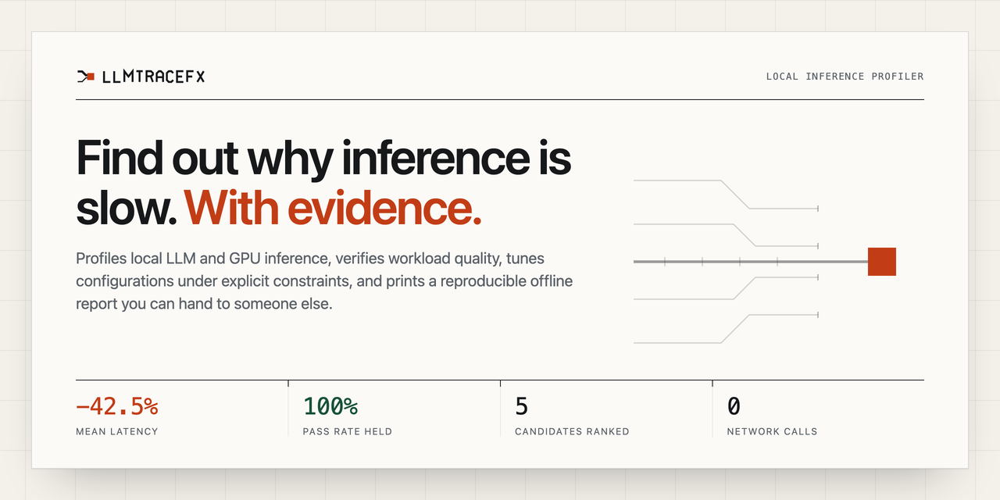

<p align="center">
  <picture>
    <source media="(prefers-color-scheme: dark)" srcset="assets/brand/llmtracefx-lockup-inverse.svg">
    
  </picture>
</p>

<p align="center">
  <strong>Measure what happened. Verify that it was correct. Optimize only what the evidence supports.</strong>
</p>

<p align="center">
  <a href="#quickstart">Quickstart</a>
  ·
  <a href="#current-capabilities">Capabilities</a>
  ·
  <a href="#research--publication">Research</a>
  ·
  <a href="SELF_HOST_GLM_RUNBOOK.md">Modal runbook</a>
  ·
  <a href="https://siddhantkhare.com/writing/ttft-http-client">Methods example</a>
  ·
  <a href="DESIGN.md">Design system</a>
</p>

<p align="center">
  <a href="https://github.com/Siddhant-K-code/LLMTraceFX/actions/workflows/ci.yml"></a>
  <a href="https://github.com/Siddhant-K-code/LLMTraceFX/actions/workflows/codeql.yml"></a>
  <a href="https://pypi.org/project/llmtracefx/"></a>
  <a href="https://pepy.tech/projects/llmtracefx"></a>
  <a href="LICENSE"></a>
  
  <a href="#perf-gate-in-ci"></a>
</p>

<p align="center">
  
</p>

<p align="center"><sub>The report values in this preview are synthetic interface examples, not benchmark results.</sub></p>

LLMTraceFX is an evidence-first inference toolkit for local models and
OpenAI-compatible streaming APIs. It collects measurements into one canonical
schema, checks model output with deterministic workloads, and recommends a
configuration only when it satisfies an explicit policy.

Related project: [agent-strace](https://github.com/Siddhant-K-code/agent-trace)
records coding-agent sessions (tool calls and decisions). LLMTraceFX measures
inference requests. The two share no code or dependencies; both can export
OpenTelemetry.

## Demo

The [evidence viewer Space](https://huggingface.co/spaces/siddhant-k-code/llmtracefx-evidence-viewer)
loading one real `collect-api` request to a local llama.cpp server
(Qwen2.5-0.5B-Instruct Q4_K_M, Apple M5 Pro) with its server metrics, then the
exported trace in Perfetto. It is a single request, not a benchmark result.

https://github.com/user-attachments/assets/fb060a1a-79d6-4f66-8d0c-735f92f0e793

## Research / Publication

Research based on earlier LLMTraceFX work is published as the peer-reviewed
conference paper **[Understanding GPU-Level Bottlenecks in Large Language Model
Inference](https://doi.org/10.1007/978-3-032-27448-9_18)** by Shubhanshu
Kushwaha, Mamata Samal, and Siddhant Khare. It appears in the *Proceedings of
International Conference on Data, Electronics and Computing: ICDEC 2025, Volume
1*, *Lecture Notes in Networks and Systems*, vol. 2003 (Springer, Cham, 2026),
pp. 211–224; first online August 2, 2026.

The paper discusses profiling LLM inference with LLMTraceFX, including memory
bandwidth, GPU interconnects, kernel overhead, and prefill/decoding. It reflects
an earlier research snapshot: this repository has continued evolving, and
current features and results should not be assumed to appear in or have been
validated by the paper.

```bibtex
@inproceedings{kushwaha2026gpu,
  author    = {Shubhanshu Kushwaha and Mamata Samal and Siddhant Khare},
  title     = {Understanding GPU-Level Bottlenecks in Large Language Model Inference},
  booktitle = {Proceedings of International Conference on Data, Electronics and Computing: ICDEC 2025, Volume 1},
  series    = {Lecture Notes in Networks and Systems},
  volume    = {2003},
  pages     = {211--224},
  publisher = {Springer},
  address   = {Cham},
  year      = {2026},
  doi       = {10.1007/978-3-032-27448-9_18},
  url       = {https://doi.org/10.1007/978-3-032-27448-9_18}
}
```

For research collaboration, reproducibility questions, or LLMTraceFX usage,
contact [siddhantkhare2694@gmail.com](mailto:siddhantkhare2694@gmail.com).
Please use [GitHub Issues](https://github.com/Siddhant-K-code/LLMTraceFX/issues)
for bug reports.

## KV-cache truth auditor demo

From a clean checkout, one offline command builds and verifies the deterministic
public proof:

```bash
make kv-cache-demo
```

It prints an expected-vs-observed table and writes the machine-readable table,
hash-bound evidence bundle, report, claim matrix, privacy-checked manifest, and
standalone verifier under `build/kv-cache-truth-demo/`. Representative rows:

| case | input | expected tokens/blocks | attested tokens/blocks | observed prompt work | verdict | output identity | evaluator | output/performance/quality eligibility |
|---|---:|---:|---:|---:|---|---|---|---|
| exact-duplicate | 9 | 8/n/a | 8/n/a | 1 | `verified_hit` | yes | yes | eligible/ineligible/not_applicable |
| interior-mutation | 9 | 3/n/a | 3/n/a | 6 | `partial_reuse` | yes | yes | eligible/ineligible/not_applicable |
| boundary-mutation | 9 | 4/n/a | 4/n/a | 5 | `partial_reuse` | yes | yes | eligible/ineligible/not_applicable |
| same-length-different-ids | 9 | 0/n/a | 0/n/a | 9 | `verified_miss` | yes | yes | eligible/ineligible/not_applicable |
| suffix-change | 9 | 8/n/a | 8/n/a | 1 | `partial_reuse` | yes | yes | eligible/ineligible/not_applicable |
| namespace-isolation | 9 | 0/n/a | 0/n/a | 9 | `verified_miss` | yes | yes | eligible/ineligible/not_applicable |
| capacity-revisit | 4 | 0/n/a | 0/n/a | 4 | `evicted` | yes | yes | eligible/ineligible/not_applicable |

The token-granular reference cache has no block observation, so block cells are
`n/a`. Timing and runtime memory remain `null`; the demo invents no benchmark
measurements. The seed, cold, and capacity-pressure rows are retained in
`truth-table.json` because they are part of the independently verified state
transition proof.

Verify the generated bundle without trusting the installed entry point:

```bash
uv run --offline --no-sync python -I \
  build/kv-cache-truth-demo/bundle/evidence_bundle.py verify \
  --public-dir build/kv-cache-truth-demo/bundle \
  --package-root .
```

This proves the auditor, independent oracle, synthetic attestation, output
evaluator, schemas, claim matrix, privacy checks, hashes, and verifier behavior.
It does **not** prove MLX or vLLM speedup, production cache correctness,
provider identity, GPU performance, latency improvement, or runtime memory
savings.

The main workflow is:

1. **Measure** with a collector or import an existing runtime artifact.
2. **Verify** the response against a pinned workload and retain failed or
   incomplete evidence.
3. **Compare and tune** candidates under one objective and stated constraints.
4. **Optimize** only after the collected evidence supports a recommendation.

## Install

```bash
uv tool install llmtracefx
```

This installs the `llmtracefx-*` commands from
[PyPI](https://pypi.org/project/llmtracefx/) into their own environment and puts
them on your `PATH`. Extras use the usual syntax, for example
`uv tool install "llmtracefx[mlx]"` on macOS arm64.

- Run one command without installing:
  `uvx --from llmtracefx llmtracefx-optimizer --help`.
- Use the library in a project: `uv add llmtracefx`.
- `pip install llmtracefx` also works.

The Quickstart below clones the repository instead, because it reads example
files from the source tree and uses the locked dependencies.

## Quickstart

The LLMTraceFX commands in this path use no API key, model download, network
request, or accelerator. Cloning the repository and installing uncached
dependencies can use the network. The commands then audit the environment,
materialize a deterministic workload plan, and write an inspectable API request
plan.

```bash
git clone https://github.com/Siddhant-K-code/LLMTraceFX.git
cd LLMTraceFX
uv sync --locked

mkdir -p output/quickstart

uv run llmtracefx-optimizer manifest \
  --output output/quickstart/environment.json

uv run llmtracefx-optimizer workloads generate-matrix \
  --model-id example/local-model \
  --model-family qwen3_next \
  --context-tiers 2k \
  --max-tokens 16 \
  --output-dir output/quickstart/matrix

env -u LLMTRACEFX_QUICKSTART_NO_KEY uv run llmtracefx-optimizer collect-api \
  --run-id api-plan \
  --provider example \
  --endpoint https://example.com/v1/chat/completions \
  --model-id example-model \
  --prompt-file examples/optimizer/api-smoke-prompt.txt \
  --output-dir output/quickstart/api-plan \
  --api-key-env LLMTRACEFX_QUICKSTART_NO_KEY \
  --dry-run
```

The last command writes `output/quickstart/api-plan/request_plan.json`. Its
`network_request_performed` field is `false`, and the dry run does not read an
API credential because the named variable is explicitly unset. In general, a
dry run does not require or transmit a credential. If its named variable is
already set, it reads the value only to detect unsafe embedding and redact the
plan.

Two more offline commands describe the optional Modal deployment harness:

```bash
uv run llmtracefx-deploy recipe
uv run llmtracefx-deploy budget --credit-usd 30
```

Neither command imports Modal, authenticates, creates resources, or performs a
network request.

## Current capabilities

### Canonical evidence

Inference collectors and the llama.cpp importer produce `ExperimentRecord`
schema version 1. Instruments collection writes a separate, typed evidence
record for trace capabilities and supported Metal tables. Numeric measurements
carry a unit and a provenance:

- `measured_native`
- `measured_wall_clock`
- `provider_reported`
- `derived`
- `estimated`

Unavailable observations remain absent. They are not converted to zeros or
relabelled as measurements.

### Collection

- **MLX and MLX-LM:** run an existing local model directory on Apple silicon
  and record normalized timing and memory evidence. LLMTraceFX does not
  download the model.
- **OpenAI-compatible streaming APIs:** record client-observed headers,
  first-byte timing, first visible content, inter-event timing, completion
  state, and provider-reported usage without persisting the credential.
- **llama.cpp:** convert captured stdout and stderr into the canonical evidence
  schema. This parser does not launch or configure llama.cpp.
- **Apple Instruments:** check `xctrace` capability, print an execution plan,
  record a local command, or import an existing trace bundle. Supported Metal
  tables are reported narrowly rather than treated as generic GPU utilization.
- **NVIDIA GPU energy (NVML):** run one command and record device wide GPU
  energy from the driver's energy counter, plus sampled power. Totals are only
  highlighted when no other process used the GPU during the window. A running
  dcgm-exporter can be read instead with `--source dcgm-exporter`.
- **Native Qwen MTP:** emit a capability report and an explicit unsupported
  record when the installed stack cannot produce trustworthy native-MTP
  evidence.
- **Server-side metrics (vLLM, SGLang, llama.cpp, TGI, TensorRT-LLM):**
  snapshot a Prometheus endpoint before and after a run and diff the two.
  Server numbers such as queue time, server TTFT and cached prompt tokens by
  cache tier are only reported when the window provably contains exactly the
  requests you sent. Otherwise the window is marked `contaminated`,
  `incomplete`, `counter_reset`, `stats_not_enabled`, or `unverifiable`. KV
  cache usage is recorded as a point sample at each scrape.
- **Trace replay (Mooncake, BurstGPT, AIPerf `single_turn` and `multi_turn`,
  Weka agentic sessions, OpenTelemetry GenAI spans):** check a published
  arrival trace, plan its schedule offline, and replay it against an
  OpenAI-compatible endpoint at the recorded arrival times. Synthetic prompts
  keep Mooncake's and Weka's prefix sharing. `export otlp` output replays
  directly. A malformed trace is refused, not repaired.

### Export to observability tools

`export otlp` writes a record as OpenTelemetry spans in OTLP/JSON, using the
GenAI semantic conventions (`gen_ai.*`). The Collector `otlpjsonfile` receiver
can read it, and it can be POSTed to any OTLP/HTTP `/v1/traces` endpoint, so
Jaeger, Tempo, Phoenix, or Langfuse can show it. `export perfetto` writes a
Chrome trace for [ui.perfetto.dev](https://ui.perfetto.dev). Both outputs are
deterministic: IDs derive from the `run_id`, and every timing keeps its
provenance as a `llmtracefx.*` attribute.

`export otlp-metrics` aggregates many API runs into GenAI histograms in
OTLP/JSON: client duration, time to first chunk, time per chunk, token counts,
and server TTFT, TPOT and request duration. The same Collector receiver reads
it, and it can be POSTed to `/v1/metrics`. A value that was not measured is
left out, never filled in. GPU energy and average power from `gpu-energy`
evidence are exported as `llmtracefx.gpu.energy` and
`llmtracefx.gpu.power.average`, since the GenAI conventions have no energy
metric.

### Perf gate

`gate` compares candidate records with baseline records of the same model,
workload, and platform, and exits 0 (pass), 1 (regression), or 2
(inconclusive). It reports inconclusive instead of guessing when a side has too
few runs, when runs are not comparable, when the metric's unit or provenance
differs, when the difference is within run-to-run noise, or when the noise is
larger than the allowed regression, so a noisy runner cannot pass by chance.
The same check ships as a GitHub Action; see [Perf gate in CI](#perf-gate-in-ci).

### Import vLLM bench and AIPerf results

`import` converts results you already have into an
`llmtracefx.imported_benchmark` artifact, without rerunning:

```bash
uv run llmtracefx-optimizer import vllm-bench vllm-result.json --output runs/base-0.json
uv run llmtracefx-optimizer import aiperf profile_export_aiperf.json --output runs/base-0.json
```

`vllm-bench` reads the file written by `vllm bench serve --save-result`.
`aiperf` reads `profile_export_aiperf.json` (schema 1.0 to 1.7). The artifact
records the source tool, its version if the file has one, and the sha256 of the
source file. Statistics the tool computed, such as `p99_ttft_ms`, are labelled
`imported_derived`, and counts it reported are labelled `imported_reported`.
They are not LLMTraceFX measurements. When `vllm bench serve` wrote
`spec_decode_*` keys, they go to a separate `speculative` section with their
units (`acceptance_rate` stays a percent, per-position rates are fractions of
drafts). vLLM scraped those from the server's counters, so they cover every
request the server handled during the run, and `gate` does not compare them.
Without the keys the section says `not_reported`. See
[`vllm/benchmarks/serve.py`](https://github.com/vllm-project/vllm/blob/1ae1b64807ff6be2a0d3f942dbad0a59a663a02a/vllm/benchmarks/serve.py#L1136-L1181). Missing fields are omitted and listed,
never guessed. Malformed files, unsupported AIPerf schemas, cancelled or
incomplete runs, runs mixing models or phases, and multi-document
`--append-result` files are refused with exit code 2. Without `--output` the
artifact is written to stdout.

Imported artifacts work with `gate` only. Gate N baseline imports against N
candidate imports from the same tool, model, endpoint and load, naming a metric
and statistic:

```bash
uv run llmtracefx-optimizer gate --baseline runs/base --candidate runs/head \
  --metric ttft_ms.p99
```

Runs are comparable only when their total input tokens match, and for latency
metrics their total output tokens too. Use a fixed dataset and seed, and for
vLLM pass `--ignore-eos` so every run generates the same number of tokens.
Otherwise the gate reports inconclusive. Runs with failed requests are not
used.

They cannot be used with `compare` (no per-prompt hashes or correctness
results), mixed with LLMTraceFX records, or gated across tools. See
[`docs/ecosystem-gap-analysis.md`](docs/ecosystem-gap-analysis.md) for the
full mapping and refusal rules.

### Load sweeps and goodput

`sweep-api` sends the same requests at several concurrency levels or request
rates and reports latency percentiles, throughput, goodput against TTFT, TPOT
and E2E targets, and whether the load generator kept up:

```bash
uv run llmtracefx-optimizer sweep-api --run-id sweep \
  --endpoint http://127.0.0.1:8000/v1/chat/completions --model-id my-model \
  --prompt-file prompt.txt --concurrency 1,4,16 --requests-per-point 64 \
  --stream-include-usage --slo-ttft-ms 500 --slo-e2e-ms 8000 \
  --output-dir results/sweep
```

Requests in a sweep overlap, so its numbers describe the server under that
load, not any single request. A sweep writes `sweep.json` and no
`record.json`, and `gate`, `compare` and `export` refuse it. Failed requests
count against goodput, and a value that cannot be checked is withheld with a
reason. Remote endpoints need `--allow-remote-load`. See
[`docs/load-sweeps.md`](docs/load-sweeps.md) for what a sweep can claim,
the goodput rules and the scheduling diagnostics. `sweep-llama-cpp` and
`sweep-mlx` run the same sweep against llama.cpp's native `/completion`
endpoint and in-process mlx-lm.

### Verification and resumability

The workload catalog covers code completion, structured JSON, and prose
reasoning across pinned context tiers. `workloads generate-matrix` writes the
prompts, hashes, runner configs, and planned commands without loading a model.

`workloads run` and `workloads run-api` verify that the prompt, workload
version, run binding, and artifact hashes still match. A complete hash-matching
run is resumed by default. Failed, partial, mismatched, and unsupported rows
remain visible instead of being scored as successes.

### Controlled vLLM crossover protocol

`llmtracefx-vllm-crossover plan` renders the preregistered Qwen3-8B vLLM
compilation crossover offline. It defines separate fixed-token-count and
natural-output lanes, eight fresh eager/compiled lifecycle pairs per lane,
counterbalanced order, whole-pair uncertainty, and a strict list-rate budget.

```bash
uv run --offline --no-sync llmtracefx-vllm-crossover plan
make vllm-crossover-verify
```

These commands do not authenticate, contact CloudRift or Modal, download a
model, use a GPU, or authorize spend. The controlled lane fixes decode-step
count, not output identity; unequal output token arrays are never described as
output-controlled. A paid `run` requires a separate exact-plan authorization
receipt and controls Docker only on an already provisioned local host. It
contains no provider or SSH client. Any temporary public-key access is managed
out of band; passwords, private keys, API tokens, host addresses, usernames,
ports, and provider credentials are not accepted. Authorization is
content-hashed, bound to the exact resolved workspace, and authenticated with
an OpenSSH detached signature against an operator-managed authorized-signers
file. It also binds the pinned image, billing start, zero-retry rule, and
external shutdown deadline. Every Docker command targets only
`unix:///var/run/docker.sock`; Docker/SSH routing environment variables are
rejected and host subprocesses receive a fixed minimal environment.

Only a fully completed 32-cell workspace can be published with
`llmtracefx-vllm-crossover-results build --workspace ... --output ...`. The
builder revalidates lifecycle, hardware, prompt, output, correctness, budget,
and teardown evidence; it resamples whole lifecycle pairs and preserves
unobservable request/compile fields as explicit nulls.
Serving cumulative time is model initialization plus measured request
durations; inter-request progress-receipt I/O is excluded and remains visible
only in host lifecycle time. A natural-lane causal-speedup claim additionally
requires correct, identical, reproducible outputs and a whole-pair timing
interval whose upper endpoint is nonpositive. Identical lifecycle-pair quality
effects are reported as deterministic observed agreement, not as a zero-width
confidence interval.
All bootstrap procedures use only eight independent lifecycle pairs and may
under-cover; controlled crossover support additionally requires the exhaustive
sign-symmetry permutation gate, while natural timing and nondegenerate quality
intervals have no such backstop.

### Modal L4 crossover protocol delta

`llmtracefx-modal-l4-crossover plan` renders a separate protocol identity,
`qwen3-8b-vllm-crossover-modal-l4-v1`, for one future Modal L4 execution of the
same sealed experiment. The scientific core is unchanged: the same pinned model
revision and runtime pins, two lanes, eight adjacent eager/compiled pairs per
lane, the same 32-cell counterbalanced schedule, 144 fixed-token-count
controlled requests and 12 natural requests per cell, whole-pair statistics
reusing the existing results core, and no extrapolation.

```bash
uv run --offline --no-sync llmtracefx-modal-l4-crossover plan
make modal-l4-crossover-bundle modal-l4-crossover-verify
```

Neither command imports the Modal SDK, authenticates, creates a container,
downloads a model, uses a GPU, or authorizes spend. **The protocol is currently
refused**: an offline arithmetic gate (described below) shows the sealed design
cannot fit one controlled cell inside its own timeout on an L4, so the
execution preflight stops before authenticating. Everything that follows
describes the preregistered design and the gates that would guard it.

Work would run through Modal Functions and RPC only, never a public web
endpoint, on one L4 with four physical CPU cores and 32 GiB, one live cell,
`max_containers=1`,
`min_containers=0`, single-input concurrency, single-use cell containers, zero
retries, and an explicit timeout per stage. Any observed second attempt, crash,
preemption, timeout, or missing terminal receipt invalidates the run and
triggers teardown.

The priced envelope is 15,240 container seconds ($4.5985056) plus a $0.48
volume reservation covering one active and four post-delete days, totalling
$5.0785056 against a $6 hard cap; the $0.9214944 contingency is never spent on
science. The application ledger is mandatory and is explicitly not provider
proof: provider-reported spend stays null until an external sanitized receipt
exists. Before execution the official rates are re-fetched and hashed, and the
run is refused if any official rate is higher or a new charge appears.
Authentication uses only the operator's standard local Modal profile;
`MODAL_TOKEN_ID`, `MODAL_TOKEN_SECRET`, profile, config, server, environment,
and routing overrides plus credential-shaped variables are rejected by name and
never read.

A fail-closed GPU memory gate runs once, ahead of the whole measured block,
as two isolated canaries; it is not re-run before each individual cell, and no
measured cell is dispatched unless both canaries pass. Runner arguments stay
BF16, tensor parallel 1, one sequence, 0.94 utilization, no prefix or
speculative decoding, and a context length of exactly the longest frozen prompt
array plus 96. CPU staging verifies 15 files and 16,397,461,266 bytes and seals
the token arrays; the eager and compiled canaries then run the actual longest
controlled prompt for 96 steps and must observe exactly one L4, the pinned
runtime, sufficient KV capacity, no OOM, a full terminal completion, and a peak
at least 512 MiB below total VRAM. Nothing is tuned to make the gate pass; a
failure publishes a refusal.

#### The approved design is infeasible on an L4, and is refused offline

Before any of that, an arithmetic gate decides whether the sealed design can
run at all, and finds that it cannot. One controlled cell generates 144 x 96 =
13,824 output tokens. Each sequential, non-speculative BF16 token requires a
complete batch-1 decoder pass. The pinned safetensors index reports
16,381,470,720 tensor bytes. The proof excludes the 1,244,659,712-byte
row-gathered input embedding, grants 16 MiB for every norm and other non-dense
tensor, excludes safetensors headers, and grants a further 128 MiB on-chip
cache allowance, leaving a conservative 14,985,816,064-byte HBM traffic floor
per token. It also grants the L4
322,122,547,200 bytes/s (300 GiB/s), more than the advertised 300 GB/s. Even
then a cell must move 207,163,921,268,736 bytes, requiring exactly
643.121455078125 seconds of decoding alone against the sealed 480-second
timeout: 1.340 times
over before container start, weight load, engine initialization, prefill, or
CUDA-graph capture. The cell needs 28.8 tokens/s while this conservative ceiling
is 21.495162213676 tokens/s.

Every input is a constant this protocol already pins, every step is exact
integer arithmetic, and the whole proof runs offline, so
`llmtracefx-modal-l4-execute preflight` refuses the run as its very first
action — before the credential-exposure gate, before authentication, before the
official-rate fetch, before the SDK is imported, and before any provider call
or spend. The assumptions are deliberately generous to feasibility (peak rather
than achieved bandwidth, weights only, no KV-cache or activation traffic, and
zero setup time), so the real figure can only be worse.

This is a refusal, not a repair. The sample size, the request and token counts,
the timeout, and the accelerator are all preregistered, so lowering *n*,
retuning the runner, extending the timeout, or moving to a different GPU would
be a different experiment rather than this one. The verdict ships in the
preregistration bundle as `decode-feasibility.json`, in the plan hash the
authorization is bound to, and in the claim matrix as
`controlled-cell-decode-feasible-on-l4`. Note that a canary could never have
caught this: one 96-token canary needs about 4.47 seconds against the
300-second eager and 420-second compiled canary timeouts and passes comfortably.

The durable refusal state records staging `0`, canaries `0/2`, analytic cells
`0/32`, retries or reschedules `0`, inferred spend `$0`, and provider-reported
spend `null`. No run-scoped identity, app, function, container, volume, or
secret was created, so teardown was not required and zero live experiment
resources is true by construction. It was not independently observed through
Modal because the control plane was never contacted. A prior process `ERROR`
was an auxiliary-agent configuration failure, not provider execution, a
scientific attempt, or permission to retry.

Modal exposes no host page-cache drop and no dedicated-host reservation, so
those CloudRift requirements are removed from this protocol only. Fresh
single-use containers, unique writable cache directories, a disabled compile
cache, a read-only shared model volume, and zero hidden warmups remain
observable; physical host reuse, host page-cache state, and volume/backend
caching do not. Placement is a narrower case: it is chosen by Modal and never
controlled, and the physical host is never identified, but whether the two
cells of a pair landed in the same *anonymized* placement group is derived
from their nonce-bound GPU commitments and published per pair. Results are
therefore descriptive, provider-conditioned paired comparisons: pure causal
compilation, hardware-matched, and natural causal speedup claims are
unsupported by construction.

#### Execution surface

`llmtracefx.optimizer.lab.qwen3_8b.modal_l4_app` is the only module in the
package that imports the Modal SDK. It declares authenticated internal
Functions over RPC and no web endpoint: a CPU staging Function on a slim image
pinned to `huggingface_hub==1.29.0`, a CPU verification Function on the
digest-pinned runtime image that checks 15 files and 16,397,461,266 bytes and
seals the prompt token arrays, two L4 canary Functions, two L4 cell Functions,
and a CPU analysis Function. Every Function is declared from the sealed plan
with four cores, 32 GiB, its own explicit timeout, `retries=0`,
`max_containers=1`, `min_containers=0`, `buffer_containers=0`, `max_inputs=1`,
`single_use_containers=True`, and one input at a time. CPU Functions carry no
accelerator argument at all, accelerated Functions mount the run-scoped model
volume read-only, and no `modal.Secret` is created or read anywhere.

Measurement is not reimplemented. The cell Function calls the existing
CloudRift crossover cell runner, so the deterministic environment, the memory
sampler, the frozen `_llm_kwargs`, the request records, and the terminal-shape
checks are the same code. There are exactly two deliberate differences. The
first is the hardware gate: the CloudRift gate admits one exact RTX 4090, so
this delta has an L4 gate that pins the accelerator name and count and records
the provider-managed driver instead of pinning it. The second is that a Modal
Function returns a value instead of leaving a file on a host, so ordinary and
out-of-memory failures become terminal refusal receipts rather than a reason
lost inside a provider stack trace.

`llmtracefx-modal-l4-execute preflight` runs every pre-SDK gate and stops before
the SDK is imported. The decode-bandwidth feasibility proof above runs first
and, for the sealed design, ends the run there. Behind it: environment overrides
are rejected by name without reading a value; the coordinator
credential-exposure attestation is read and must be cleared; the authorization
is verified against an OpenSSH detached signature and bound to the exact plan
hash, clean source head, nonce, run-scoped names, image reference, workspace
path, rate-receipt hash, credential-exposure attestation hash, and
signed-headroom receipt hash, inside a bounded UTC `[not_before, expires_at)`
window with an explicit maximum duration; the source-checkout gate confirms
real git is clean at exactly that head; the official rate documents are
re-fetched and hashed (never parsed for numbers); and account headroom comes
from a sanitized control-plane probe or a separately signed operator receipt —
never from silence. That headroom receipt is not a bare dollar figure: it is a
closed schema carrying the protocol, plan hash, source head, nonce, amount, and
its own strict UTC validity window, which must cover the whole authorization
window, and the authorization names its exact hash so a receipt signed for one
run cannot be replayed into another. No account, workspace, or profile
identifier may appear in it.

`run` would then import the SDK, probe it against the pinned and inspected Modal
1.6.4 API surface, and validate the standard local Modal profile with a
read-only probe whose output is discarded, all before the app module is
imported or any resource-creating or paid provider operation begins. Only then
would it execute staging, verification, the eager canary, the
compiled canary, the 32 sealed cells only if both canaries pass, and the
analysis inventory, sequentially, reserving each lifecycle in the ledger before
every call. A second attempt, crash, preemption, timeout, or missing terminal
receipt stops the run where it stands, with no replacement cells.

Teardown runs in a `finally` on every path: the outstanding call is retained
until it is cancelled with container termination, the ephemeral app context
exits (a local action, never claimed as provider deletion proof), the run-scoped
volume is deleted, and the volume listing — the only named-resource inventory
Modal exposes — is read back into a sanitized receipt. Scale-to-zero is read
from function autoscaler stats, but not as a single sample the instant the
context exits: the scaledown window for these functions is two seconds and the
control plane is eventually consistent, so one immediate reading observes
timing rather than teardown. The gate polls within an exact, finite budget
instead — at most twelve samples five seconds apart, 55 seconds worst case —
and a function that has not reported zero by the deadline is recorded as
unverified. Re-reading an autoscaler counter is control-plane cleanup
verification, never a scientific retry: nothing measured is re-run, no call is
re-dispatched, and the one-attempt-per-lifecycle rule is untouched.

Modal exposes no per-container delete, no `App.stop()`, and no app or container
inventory, so none is claimed; each is published as an explicit unsupported
control, as is the absence of a pre-run spend authority, and any ambiguity (a
listing that could not be performed) fails the teardown closed. A complete run
whose teardown is incomplete is a refusal, not a result — but a refusal keeps
its evidence. Cells and canaries that were already dispatched were already paid
for, so their terminal receipts are written under a clearly-named
`refused-evidence/` subtree alongside a `refusal-receipt.json`. None of those
names is a name the result path reads, so a refusal still cannot be replayed as
a result, and no paid receipt is thrown away because a later control-plane
observation turned out to be ambiguous.

The provider-native results analysis remains implemented and adversarially
tested for auditability, but it is dormant for this protocol identity.
`modal_l4_crossover_results.analyze_modal_run` requires the exact sealed
feasibility receipt, which is negative, so no completed result bundle can be
accepted. Its orchestration SHA-256 is an integrity checksum, not an
authenticity proof. Any future feasible protocol identity must add an external
trust anchor for authorization and execution receipts before enabling result
publication; it must not reinterpret this identity's hypothetical-device test
fixtures as evidence.

#### Credential exposure gate

A standard-profile credential was exposed outside this system. The coordinator
reports that it was never used by the experiment, was revoked, and was replaced
through the normal local flow without sharing; no value or derived identifier
was recorded. If a future feasible protocol is separately approved, provider
execution stays blocked until those facts are supplied as a signed execution
gate artifact in the closed booleans-only schema. The
feasibility refusal runs first; the credential gate would run second, before the
environment check, authorization verification, or SDK import. An absent or
malformed attestation is a refusal, never an assumption of clearance.

The attestation and every stored verdict record status only —
`exposed_profile_credential_never_used_by_experiment`,
`exposed_profile_credential_revocation_confirmed`,
`fresh_local_profile_created_without_sharing`,
`fresh_profile_shared_anywhere`, a confirmer name, a timestamp, and a short
reason. Fields whose names look like a token, a secret, a hash, a prefix, a
fingerprint, an account, or screenshot metadata are refused by name, extra
fields outside the allowlist are refused, and a reason that looks
credential-shaped is refused without being stored. No credential value, hash,
prefix, or derived identifier is ever read or written by this code. The
authorization receipt binds the hash of that booleans-only attestation
document, so a cleared gate cannot be swapped for another after signing, and a
completed result bundle is refused unless its gate verdict is cleared.

The evidence schema has no separate `refuted` state, so the offline-disproved
L4 feasibility claim is encoded as `unsupported` with explicit
`offline_decode_bandwidth_arithmetic` provenance and the arithmetic receipt.

### Tune within one target

`tune` reads existing `verification.json` and `final_record.json` files. It
does not load a model or execute a benchmark. A policy chooses one objective
and can constrain pass rate, quality metric, peak memory, latency, provenance,
repetition count, and coefficient of variation.

```bash
uv run llmtracefx-optimizer tune \
  --results output/results \
  --policy examples/optimizer/tune-policy-fastest-under-20gb-m5-pro.json \
  --output output/tune-report.json \
  --explain

uv run llmtracefx-optimizer tune-report \
  --input output/tune-report.json \
  --output output/tune-report.html
```

The HTML report is a deterministic, self-contained view with inline CSS, no
JavaScript, and no CDN. Local paths are redacted unless `--include-paths` is
set.

### Cross-system comparison

`tune` compares configurations within one model and hardware target. `compare`
works across already-collected local and hosted systems. It is offline: it
loads no model, calls no API, deploys nothing, and runs no benchmark.

The command accepts only result directories shaped by `workloads run` or
`workloads run-api`: each row must have `verification.json` and the referenced
`final_record.json`. API rows also validate the collector's
`api_evidence.json` and completion marker. Flat `collect-api` output is not
accepted because it has no workload verification or quality result.

Use separate result directories for repetitions. Reusing one directory resumes
the completed row instead of measuring it again. Pass every repetition to
`--results`; duplicate paths count once.

```bash
uv run llmtracefx-optimizer compare \
  --results \
    artifacts/local/rep-1 artifacts/local/rep-2 \
    artifacts/frontier-api/rep-1 artifacts/frontier-api/rep-2 \
    artifacts/flash-api/rep-1 artifacts/flash-api/rep-2 \
  --policy examples/optimizer/compare-policy-local-vs-api-latency.json \
  --output artifacts/cross-system-compare.json \
  --explain

uv run llmtracefx-optimizer compare-report \
  --input artifacts/cross-system-compare.json \
  --output artifacts/cross-system-compare.html
```

Systems are compared only within a comparable stratum: identical workload and
version, prompt hash, context tier, evaluator, output cap, sampling, and request
shape. Different or unknown settings remain separate. System identity retains
model and revision, provider, runtime and backend, accelerator, quantization,
reasoning settings, endpoint route, decode mode, and collection configuration.

The report can carry pass rate, quality, total latency, client or local
first-token timing, correct cases per minute, provider-reported usage, and
estimated cost metrics where those values exist. It does not:

- rank local prefill timing against hosted client-observed time to first visible
  content;
- invent hosted peak memory or replace missing evidence with zero;
- combine objectives into a blended score;
- choose a winner when the evidence is tied, within noise, or limited to one
  system.

Cost objectives require `--pricing` with a versioned manifest. No rates are
built in or fetched. Every monetary result is estimated from provider-reported
usage and the supplied rate entry. The file
`examples/optimizer/pricing-manifest-illustrative.json` contains invented
demonstration values and must not be used as a current price list.

`compare-report` renders a deterministic, self-contained HTML file. Paths and
endpoint hosts are redacted by default; `--include-paths` is explicit opt-in.
Prompt text, response text, reasoning content, and credentials are not fields
in the comparison schema.

See the synthetic, non-benchmark
`examples/optimizer/compare-report-example.json` and the example policies
`compare-policy-local-vs-api-latency.json` and
`compare-policy-cost-per-correct-case.json`.

### Optimize an approved path

`optimize` composes matrix execution, tuning, and optional HTML rendering. Its
`--dry-run` path lists selected rows, blockers, and expected artifacts without
loading a model or tuning:

```bash
uv run llmtracefx-optimizer optimize \
  --matrix output/quickstart/matrix/manifest.json \
  --model-path /existing/local/mlx/model \
  --results output/results \
  --policy examples/optimizer/tune-policy-fastest-under-20gb-m5-pro.json \
  --dry-run
```

## Prerequisites by path

| Path | Requirements | Install or check |
| --- | --- | --- |
| Offline planning and report inspection | Python 3.11+ and `uv` | `uv sync --locked` |
| Local MLX collection | macOS on arm64, MLX, MLX-LM, and an existing local model directory | `uv sync --locked --extra mlx` |
| Metal and `xctrace` | macOS, full Xcode command-line tools, and a locally available Instruments template | `uv run llmtracefx-optimizer instruments capability` |
| NVIDIA GPU energy | Linux or Windows with an NVIDIA driver, and the optional `nvml` extra | `uv sync --locked --extra nvml`, then `uv run llmtracefx-optimizer gpu-energy capability` |
| Hosted API collection | An HTTPS OpenAI-compatible endpoint and a provider key stored in an environment variable | Use `collect-api --dry-run` before making a request |
| Modal planning | No Modal account or SDK is required | `uv run llmtracefx-deploy plan --help` |
| Modal execution | An approved plan, current price inputs, Modal account and auth, optional `modal` extra, proxy auth token, pinned model revision, and pinned serving image | `uv sync --locked --extra modal` (the constraint is still `>=1.0.5`, but the lock now resolves `modal==1.6.4`) |
| Modal L4 crossover execution | Currently refused: the sealed design is infeasible on an L4. Would otherwise need a signed authorization, cleared credential-exposure attestation, fresh rate receipt, run-bound signed headroom, and the exactly pinned SDK | `uv sync --locked --extra modal-l4-execute` (installs `modal==1.6.4`) |

Hosted API requests, Modal staging, deployment, health checks, and inference can
incur provider charges. None runs from the quickstart or from
`llmtracefx-deploy recipe`, `budget`, or `plan`.

## Measure

### Local MLX

```bash
uv run llmtracefx-optimizer collect-mlx \
  --run-id local-baseline \
  --model-path /existing/local/mlx/model \
  --model-id organization/model \
  --model-revision <pinned-revision> \
  --prompt-file examples/optimizer/mlx-smoke-prompt.txt \
  --output-dir output/local-baseline \
  --max-tokens 64 \
  --seed 0
```

The model path must already exist. Generic external draft-model speculation is
available through `--draft-model-path`; it is labelled `draft-model`, not
native MTP.

### OpenAI-compatible API

Start with `--dry-run`. For a real request, load the key without putting it in
the command line or shell history, then remove `--dry-run`. This Bash example
uses a silent prompt:

```bash
read -rsp "Provider API key: " PROVIDER_API_KEY
printf "\n"
export PROVIDER_API_KEY

uv run llmtracefx-optimizer collect-api \
  --run-id hosted-baseline \
  --provider provider-name \
  --endpoint https://provider.example/v1/chat/completions \
  --model-id provider-model-id \
  --prompt-file examples/optimizer/api-smoke-prompt.txt \
  --output-dir output/hosted-baseline \
  --api-key-env PROVIDER_API_KEY \
  --max-output-tokens 64

unset PROVIDER_API_KEY
```

The key value is accepted only through the named environment variable. A
credential manager or shell integration is preferable for repeated use. Check
the provider's current prices and data-handling terms before sending a request.

The article
[What your TTFT benchmark is really measuring](https://siddhantkhare.com/writing/ttft-http-client)
is a practical methods example. It explains why client buffering, empty SSE
events, hidden reasoning, and truncated streams change what a time-to-first-
token number means.

#### Server-side view of the same request

When you run the server yourself, add `--server-metrics-url` to see what the
engine recorded for the request:

```bash
uv run llmtracefx-optimizer collect-api \
  --run-id local-vllm \
  --provider vllm \
  --endpoint http://127.0.0.1:8000/v1/chat/completions \
  --model-id my-model \
  --prompt-file examples/optimizer/api-smoke-prompt.txt \
  --output-dir output/local-vllm \
  --api-key-env VLLM_API_KEY \
  --server-metrics-url http://127.0.0.1:8000/metrics
```

`server_metrics_evidence.json` is written next to the record. Its highlights
appear only when the server's request counter rose by exactly one and nothing
was queued or running when the window opened. llama.cpp exposes no request
counter, so its windows are `unverifiable` unless you pass
`--server-metrics-assume-isolated`. That records the result as
`operator_asserted`, not as a measurement. For other workflows, use
`server-metrics snapshot` before and after, then `server-metrics diff
--expected-requests N`. It exits 2 when the window cannot be attributed.

The evidence also has a `speculative` block built from the server's
speculative decoding counters (vLLM `vllm:spec_decode_*`, SGLang
`sglang:spec_verify_calls_total`, llama.cpp `llamacpp:spec_decode_*`,
TensorRT-LLM `trtllm_spec_decode_num_{draft,accepted}_tokens_total`). Its
`status` is `measured`, `no_drafts` (the counters exist but did not move),
`not_exported`, `withheld` (the window is not attributable) or `unsupported`
(the runtime profile names no such counters). Only `measured` carries values:

| Field | Provenance | How |
| --- | --- | --- |
| `counters.verify_steps`, `.draft_tokens`, `.accepted_tokens`, `.emitted_tokens` | `measured_native` | counter delta over the window |
| `acceptance_rate` | `derived` | accepted draft tokens / proposed draft tokens |
| `acceptance_length` | `derived` | 1 + accepted / verification steps, or emitted tokens / verification steps when the server counts no accepted tokens |
| `per_position_acceptance_rate` | `derived` | accepted at each draft position / verification steps (vLLM, llama.cpp) |

Each derived value states its `source` and `basis`, and anything the server's
counters cannot give is listed under `not_derived`. SGLang counts verification
calls but not accepted drafts, so only its acceptance length is derived, and
its `sglang:spec_accept_*` series are last-value gauges that are never
differenced (they are listed under `ignored_gauges`). TensorRT-LLM counts
proposed and accepted drafts but not verification steps, so only its
acceptance rate is derived. It logs them from iteration stats, so they need
`enable_iter_perf_stats: true`. Sources:
[vLLM counters](https://github.com/vllm-project/vllm/blob/1ae1b64807ff6be2a0d3f942dbad0a59a663a02a/vllm/v1/spec_decode/metrics.py#L195-L292),
[SGLang gauges and counters](https://github.com/sgl-project/sglang/blob/b6d4389a77970e31817536c3e182256fae6a6f73/python/sglang/srt/observability/metrics_collector.py#L548-L583),
[llama.cpp counters](https://github.com/ggml-org/llama.cpp/blob/ebc9fb933e774bb4ac0ba497a67948e16b7e5656/tools/server/server-task.cpp#L1568-L1660),
[TensorRT-LLM counters](https://github.com/NVIDIA/TensorRT-LLM/blob/e6ecd280fd1f77cad6496f81a7194afe29f8d5e8/tensorrt_llm/metrics/collector.py#L550-L567).

`doctor speculative` reads `server_metrics_evidence.json` next to each
speculative record. When every speculative run has `measured` acceptance, the
server's view can overrule the latency comparison: a run whose server ran no
verification step makes the result `inconclusive`, zero accepted drafts is a
`regression`, and a speed-up larger than the acceptance length is
`inconclusive`. Otherwise the latency verdict stands. The report's `basis` is
`server_acceptance` or `client_latency`, and `acceptance` holds the pooled
counters.

Cache counters are split where the engine splits them. `cached_prompt_tokens_by_tier`
carries a `breakdown` by vLLM `source`, SGLang `cache_source`, or TensorRT-LLM
`cache_tier`. vLLM also reports prompt tokens by `source`, external prefix
cache hits, and KV offload load and store bytes and time. Offload falls back
to the deprecated `kv_offload_total_*` counters, split by `transfer_type`,
when the new ones are absent. SGLang HiCache
host and storage counters are repeated on every tensor and pipeline parallel
rank, so they are read from the lowest rank (`delta_one_rank`) with
`ranks_agree` recorded, and host hits count the `kv` pool only. llama.cpp
`prompt_tokens_total` excludes cached tokens, so `prompt_tokens` adds
`prompt_tokens_cached_total`. Builds without that counter report
`computed_prompt_tokens` instead. KV usage gauges (vLLM `kv_cache_usage_perc`,
SGLang `token_usage` and `kv_*_tokens`, TensorRT-LLM KV utilization) are never
diffed. They appear under `kv_usage` as before and after samples for every
window, attributed or not.

`trtllm-serve` serves Prometheus text on `/prometheus/metrics`, not
`/metrics`, and only when the `--config` YAML sets `return_perf_metrics:
true`. Set `enable_iter_perf_stats: true` too for the running and waiting
gauges. Without the request counter the window is `stats_not_enabled`, and
without the gauges it is `unverifiable` unless you pass
`--server-metrics-assume-isolated`. Both are listed under
`attribution.missing_stats`.

#### Server numbers in the response

vLLM (`--enable-per-request-metrics`), SGLang and TensorRT-LLM can return
their own queue time, TTFT and speculative decoding counts inside each
response. `collect-api`, `sweep-api` and `replay run` record them as
`provider_reported` under `server_reported` and in `server_*` row fields,
next to the client's timing and never in place of it. SGLang needs
`--sglang-return-details` and TensorRT-LLM needs `--trtllm-return-metrics`;
both change the request, so both are part of the config hash. A server that
sends nothing leaves nothing. See
[Per-request server numbers](docs/load-sweeps.md#per-request-server-numbers)
for the field mapping and the pinned upstream sources.

#### Viewing a run as a trace

```bash
uv run llmtracefx-optimizer export perfetto \
  --record output/local-vllm/record.json \
  --api-evidence output/local-vllm/api_evidence.json \
  --server-metrics output/local-vllm/server_metrics_evidence.json \
  --output output/local-vllm/trace.json
```

Open `trace.json` in [ui.perfetto.dev](https://ui.perfetto.dev). Swap
`perfetto` for `otlp` to get OTLP/JSON instead.

#### Exporting GenAI metrics

```bash
uv run llmtracefx-optimizer export otlp-metrics output/ \
  --output output/genai-metrics.jsonl
```

Pass record files or directories. Directories are searched for `record.json`,
and `api_evidence.json` and `server_metrics_evidence.json` next to each record
are used when present. All runs go into one cumulative histogram per metric
and attribute set. Each point carries `llmtracefx.provenance` and
`llmtracefx.source`, so values measured in different ways stay apart, and each
run is linked to its `export otlp` trace through an exemplar. Local runs are
skipped. Every value that is left out is listed as `Not exported: ...`.

| Metric | Derived from | Left out when |
| --- | --- | --- |
| `gen_ai.client.inference.duration` | `record.timing.total` | no total in ms |
| `gen_ai.client.inference.time_to_first_chunk` | first reasoning or content event in the API timeline | not streamed, no chunk arrived, or the run ended in tool calls |
| `gen_ai.client.inference.time_per_output_chunk` | gaps between consecutive reasoning or content events | as above, or fewer than two chunks, or the event list was truncated |
| `gen_ai.client.inference.operation.input_tokens`, `.output_tokens` | `record.tokens` | token counts are estimated or have no provenance |
| `gen_ai.server.time_to_first_token` | vLLM or SGLang TTFT histogram | the server window is not attributable, holds more than one request, or the run failed |
| `gen_ai.server.time_per_output_token` | vLLM or SGLang TPOT histogram | as above; vLLM records 0 for one-token replies, and TGI's per-token mean includes prefill, so neither is mapped |
| `gen_ai.server.request.duration` | vLLM, SGLang or TGI end to end latency histogram | as above |
| `llmtracefx.gpu.energy`, `llmtracefx.gpu.power.average` | `gpu_energy_evidence.json` next to the record | the evidence is refused, its window is shared with another run, or the run failed |

### Trace replay

`replay` sends a published arrival trace to an OpenAI-compatible endpoint at
the times the trace records. Six formats are read, each named with
`--format` and never guessed from the file:

- `mooncake`: Mooncake JSONL with `timestamp` (ms), `input_length`,
  `output_length` and `hash_ids` (one id per 512-token block by default, see
  `--block-size`).
- `burstgpt`: the BurstGPT CSV (`Timestamp`, `Model`, `Request tokens`,
  `Response tokens`, `Total tokens`, `Log Type`). Rows with zero tokens are
  refused unless `--exclude-failed` drops and counts them.
- `aiperf-single-turn`: AIPerf `single_turn` JSONL with `timestamp` (ms),
  `text` and `output_length`. This covers ShareGPT-style prompts with arrival
  times.
- `aiperf-multi-turn`: AIPerf `multi_turn` JSONL. Lines with the same
  `session_id` form one session. A session's first turn is sent at its
  `timestamp`; each later turn waits for the previous one to complete, then
  for its `delay` or until its `timestamp`. Its prompt resends the earlier
  turns, with synthetic answers whose length is each turn's `output_length`.
  Select with `--max-sessions`; `--max-requests` is refused because it would
  cut a session. Mooncake has no multi-turn format, so its conversation trace
  is read with `mooncake`.
- `weka`: Weka's Claude Code session traces
  ([spec](https://github.com/callanjfox/agentic-coding-analysis/blob/15e88f72f902c7852c330caf2cc11722e5dbc1aa/docs/TRACE_FORMAT.md)),
  one conversation per line with its `block_size` and a `requests` list of
  `t` (s), `in`, `out`, `hash_ids` and `api_time`. A conversation is a session.
  Its `hash_ids` name blocks within that conversation only, so the same id on
  two lines is two different texts. Every conversation in these traces starts
  near `t` 0, so pick a few with `--max-sessions`. Subagent entries, a
  `hash_id_scope` other than `local`, and a `block_size` that differs between
  lines are refused; `--block-size` is refused because the file declares it.
- `otel-genai`: OTLP/JSON trace exports, one `TracesData` per line, read with
  the GenAI semantic conventions
  ([pinned](https://github.com/open-telemetry/semantic-conventions-genai/tree/76e0c19e7fe11dc693fe258642363a438af4d3aa)).
  Each `chat`, `text_completion` or `generate_content` span is one request,
  with `gen_ai.usage.input_tokens` and `gen_ai.usage.output_tokens` as its
  lengths and its start time as its arrival. Spans of one `traceId` form a
  session. Agent, tool and embedding spans are skipped and counted, and a span
  with token usage but no `gen_ai.operation.name` is refused as ambiguous.
  Deprecated `gen_ai.usage.prompt_tokens` and `completion_tokens` are used
  only when the current name is absent. Failed spans (status `ERROR` or an
  `error.type`) are refused unless `--exclude-failed` drops and counts them.
  Prompt and message attributes are never read.

```bash
# No network: check the file, then write the schedule.
uv run llmtracefx-optimizer replay validate trace.jsonl --format mooncake
uv run llmtracefx-optimizer replay plan trace.jsonl --format mooncake \
  --time-scale 0.5 --max-requests 1000 --output-dir replay-plan

# Send it to a local server.
export LOCAL_KEY=unused
uv run llmtracefx-optimizer replay run trace.jsonl --format mooncake \
  --time-scale 0.5 --max-requests 1000 \
  --endpoint http://127.0.0.1:8000/v1/chat/completions \
  --model-id my-model --api-key-env LOCAL_KEY --output-dir replay-run \
  --server-metrics-url http://127.0.0.1:8000/metrics
```

Mooncake, BurstGPT, Weka and OTel give lengths, not text, so prompts are
synthetic. One
word stands in for one token, so the planned prompt length is labelled
`estimated` and the provider's `prompt_tokens` is recorded next to it. Every
Mooncake hash block becomes the same text wherever it appears, so requests
that share leading `hash_ids` share a byte-identical prefix. Prompt text
comes from a salt that is random per run unless `--prompt-salt` is given, so
a replay never hits cache entries left by an earlier one. Prompt text is never
written to disk; only its sha256 is.

In `weka` and `otel-genai` traces a session's first request is sent at its
recorded start. Each later request waits until the previous one completes,
then for the idle gap the trace recorded between the previous request's end
(`t` plus `api_time`, or the span's end) and its own start. When the trace has
no end for the previous request, or it overlapped this one, the request waits
for the previous one and its own recorded start instead. AIPerf's Weka reader
sends such a request at once; waiting for the recorded start keeps the trace's
spacing. `validate` counts how many requests used each rule. Neither format
resends earlier turns: each request is one prompt of its recorded input
length. Weka prompts are built from hash blocks like Mooncake's, so requests
in a conversation share their recorded prefix; leftover tokens past the last
hashed block are text unique to that request. OTel spans carry no block ids,
so their prompts share nothing. Concurrent spans of one trace, such as
parallel subagent calls, are sent one after another.

`export otlp` writes one line per run, so exported runs replay as they are.
Each run becomes a session of one request:

```bash
uv run llmtracefx-optimizer export otlp --record run1/record.json \
  --api-evidence run1/api_evidence.json --output run1.otlp.json
cat run1.otlp.json run2.otlp.json > runs.jsonl
uv run llmtracefx-optimizer replay plan runs.jsonl --format otel-genai \
  --output-dir replay-plan
```

Raw session ids, `traceId`s and conversation ids are never written; sessions
are numbered by first arrival.

`--tokenizer` makes synthetic lengths exact. It takes a Hugging Face repo id
(`--tokenizer-revision` pins a branch, tag or commit), a `tokenizer.json`
file, or a directory holding one, and needs the optional extra
(`uv sync --extra tokenizer`). Prompts then use only words that are one token
each, and every prompt is encoded and checked: it must be exactly the trace's
length, one token per word, so Mooncake block boundaries fall on token
boundaries. A merge between words refuses the plan instead of padding or
trimming. Lengths are labelled `tokenizer_exact` and count the prompt text
only; the chat template and special tokens the server adds are not counted,
and the result reports provider `prompt_tokens` minus the tokenizer count.
The schedule records the tokenizer name, tokenizer.json sha256, revision and
resolved commit. For multi-turn traces each synthetic answer is checked the
same way, and a turn's count is the sum of its messages, each encoded on its
own.

`--time-scale` multiplies every gap between arrivals. `--start-s`, `--end-s`
and `--max-requests` choose a window. `max_tokens` is the trace's output
length; `--ignore-eos` asks vLLM and SGLang to generate all of it. `run`
refuses a non-loopback endpoint unless `--allow-remote-load` is given, because
it can send thousands of requests.

`run` writes `replay_schedule.json`, `replay_requests.jsonl` (one line per
request, with its scheduled, sent and completed offsets, TTFT, E2E and token
counts) and `replay_result.json`. The result records the trace sha256, the
selection and scaling, dispatch lag percentiles, and a fidelity verdict:
`faithful` when every request was sent and p99 dispatch lag is within
`--max-dispatch-lag-s` (0.05 s by default), `lagged` when lag went over it,
and `incomplete` when Ctrl-C stopped the run early. The exit code is 0 when
faithful, 2 when lagged or incomplete, and 1 on errors or when every request
failed.

### Apple Instruments and Metal

Check support before recording:

```bash
uv run llmtracefx-optimizer instruments capability

uv run llmtracefx-optimizer instruments plan \
  --output-trace output/metal.trace \
  --output-dir output/metal \
  --time-limit 30s \
  -- /path/to/local-command --its-argument
```

`plan` prints the exact `xctrace` invocation and runs no target command. The
recording path uses `record` in place of `plan`. Current parsing supports the
`metal-gpu-intervals` table and reports interval counts, duration sums, and
wall spans. It does not infer GPU utilization, occupancy, bandwidth, power, or
energy from those intervals.

A public, reproducible Apple Silicon example with a deterministic Metal
workload, sanitized measured evidence, integrity hashes, and charts lives in
[`examples/metal_evidence/`](examples/metal_evidence/README.md). Raw trace
bundles and XML exports are excluded by design.

### NVIDIA GPU energy (NVML)

Install the optional extra and check support:

```bash
uv sync --locked --extra nvml
uv run llmtracefx-optimizer gpu-energy capability

uv run llmtracefx-optimizer gpu-energy record \
  --output output/gpu-energy.json \
  -- python my_inference.py
```

`record` reads the NVML energy counter on each GPU before and after the
command and polls power every 100 ms while it runs. The evidence keeps two
energy figures apart:

- `energy` is the energy counter delta, labelled `measured_native`.
- `sampled_power_integral` is a trapezoid over the power samples, labelled
  `estimated`.

Both are device wide, so they include idle power and anything else on the
GPU. On every tick, `record` also asks NVML which processes use the selected
GPUs. A process that is not the command or one of its children makes the
window `contaminated`. When this cannot be checked, for example from inside a
container's PID namespace or with MIG enabled, the window is `unverifiable`.
Totals are only highlighted for an attributable window. To measure an
inference server that the command calls, pass its PID with `--gpu-pid`, for
example around `collect-api`. Exit codes: 0 attributable, 2 written but not
attributable, 1 on error or when the command fails, 3 when NVML is
unavailable.

To attach the energy to a record, save the evidence as
`gpu_energy_evidence.json` next to its `record.json`. `gate` and
`export otlp-metrics` read it from there, and `export otlp` or `perfetto`
take it with `--gpu-energy FILE`. The record file is never rewritten. Only an
attributable window that exited 0 and contains the whole run fills
`power.energy` (the counter delta) and `power.average_power`; anything else is
refused with a reason in `power.source.refused_reason`. The sampled power
integral is never used. Runs that share one window, or whose windows overlap
another run, are refused too.

To read a running [dcgm-exporter](https://github.com/NVIDIA/dcgm-exporter)
instead, pass `--source dcgm-exporter --dcgm-exporter-url
http://HOST:9400/metrics` to `capability` or `record`. No extra is needed.
`record` scrapes `/metrics` until the energy counter
(`DCGM_FI_DEV_TOTAL_ENERGY_CONSUMPTION` in mJ, or
`DCGM_FI_DEV_GPU_ENERGY_JOULES_TOTAL` in J from 4.9.0) changes before the
command, and again after it exits. The exporter adds no timestamps and
refreshes every `--collect-interval` (30 s by default), so the delta covers
more than the command. The evidence records the shortest and longest span the
delta can cover, and refuses `energy` with `bracket_too_wide` when the command
is less than `--min-run-share` (0.9) of the longest span. Run the exporter
with a short interval, for example `-c 1000`, and long commands. Power is
listed per scrape but not integrated, and the window is `unverifiable`
because the exporter has no process list. In a record, its evidence fills
only `power.energy`, and only with `--assume-isolated`.

## Verify, tune, and optimize

Generate a matrix for an existing model:

```bash
uv run llmtracefx-optimizer workloads generate-matrix \
  --model-id organization/model \
  --model-family qwen3_next \
  --target-model-path /existing/local/mlx/model \
  --output-dir output/matrix
```

Inspect execution without loading the model:

```bash
uv run llmtracefx-optimizer workloads run \
  --matrix output/matrix/manifest.json \
  --model-path /existing/local/mlx/model \
  --output-dir output/results \
  --mode autoregressive \
  --dry-run
```

Remove `--dry-run` to execute the selected MLX rows. Re-running the same command
resumes complete hash-matching rows. Pass `--no-resume` only when a deliberate
rerun is required.

For a hosted API, use `workloads run-api`. Its `--dry-run` validates selection,
endpoint configuration, and credential handling without a request:

```bash
uv run llmtracefx-optimizer workloads run-api \
  --matrix output/matrix/manifest.json \
  --output-dir output/api-results \
  --provider provider-name \
  --endpoint https://provider.example/v1/chat/completions \
  --model-id provider-model-id \
  --api-key-env PROVIDER_API_KEY \
  --mode autoregressive \
  --dry-run
```

With `--budget-plan`, `--budget-ledger`, and `--budget-request-id`, each
request is claimed in a sealed ledger at its full price ceiling before any
network I/O. A ledger entry is `planned`, `attempted`, `completed`, `failed`, or
`abandoned`. A request ID is never attempted twice. A `failed` request blocks
later requests for its model permanently. An `attempted` request whose process
died before settlement also blocks its model, until an operator records it:

```bash
uv run llmtracefx-optimizer workloads abandon-budget-request \
  --budget-plan budget-plan.json \
  --budget-ledger budget-ledger.json \
  --budget-request-id request-id \
  --reason "runner was killed before settlement"
```

The entry becomes `abandoned`, keeps its full ceiling charged, and the reason
is appended to the ledger events. That request ID can never be retried.

Then run `tune`, `tune-report`, or `optimize` against the verified result
directory. The example policy files under `examples/optimizer/` are labelled
examples and contain no benchmark claim.

## Perf gate in CI

Commit baseline `record.json` files for a workload, produce candidate records
in your own job (on the hardware you care about, since hosted runners have no
GPU or Apple silicon), then gate the pull request:

```yaml
- uses: Siddhant-K-code/LLMTraceFX@v1
  with:
    baseline: perf/baseline          # files or directories of record.json
    candidate: output/candidate
    metric: decode_tokens_per_second # or total, prefill, decode, ...
    max-regression: "0.05"           # fail beyond 5% worse
    min-repetitions: "3"
```

The action needs only the standard library, so it installs nothing beyond
Python. It writes a Markdown table to the job summary and exposes `verdict`
(`pass`, `regression`, or `inconclusive`) and `report` (JSON path) as
outputs. Set `fail-on-inconclusive: "false"` to report without failing when
the runs are too few or too noisy to decide. `@v1` follows the latest 1.x
release. Pin a release tag such as `@v1.11.0` or a commit SHA for fully
reproducible CI.

`metric` can also be `energy`, `average_power` or `energy_per_output_token`,
read from a `gpu_energy_evidence.json` next to each record (see
[NVIDIA GPU energy (NVML)](#nvidia-gpu-energy-nvml)). Energy per output token
is derived from the counter energy and a measured or reported generated token
count. Runs must use the same GPUs and attribution status. A successful run
with no usable value makes the gate inconclusive rather than being dropped.

The baseline and candidate can also be directories of imported vLLM bench or
AIPerf artifacts (see
[Import vLLM bench and AIPerf results](#import-vllm-bench-and-aiperf-results)),
with a metric such as `ttft_ms.p99`.

The same check runs locally:

```bash
uv run llmtracefx-optimizer gate \
  --baseline perf/baseline --candidate output/candidate \
  --metric total --max-regression 0.05 --output gate.json
```

## KV-cache truth auditing

`llmtracefx-cache-audit` checks whether a cache claim is supported by exact
token identity, the pinned cache policy, observed prompt work, and output
correctness. Cached-token counts, timing, memory, and cost remain separate claim
dimensions; missing values remain unavailable.

The built-in synthetic positive control is offline and download-free:

```bash
uv run llmtracefx-cache-audit run \
  --backend reference \
  --publication-mode public_synthetic \
  --output-dir output/cache-audit
uv run llmtracefx-cache-audit verify output/cache-audit
```

See [the cache-audit guide](docs/cache-audit.md) for MLX-LM 0.31.3 semantics,
the vLLM 0.28.0 refusal gate, bundle privacy modes, and verdict definitions.

## Modal deployment

`llmtracefx-deploy` is a planning CLI for the pinned GLM-5.3-Flash harness. It
prints model facts, recommends a session cap from an operator-supplied credit
balance, and evaluates a proposed deployment from operator-supplied prices and
limits.

The planner is no-spend by construction. It does not deploy, authenticate,
open a socket, import Modal, download weights, call an API, or allocate an
accelerator. If required inputs or safety gates fail, it withholds paid
commands from its executable set.

Its calculated cost envelope is planning arithmetic, not a Modal billing
guarantee. Provider scheduling, billing granularity, traffic that reaches the
deployment, price changes, failed starts, and resources outside the declared
inputs can still affect the bill. Follow the full
[Modal GLM-5.3-Flash runbook](SELF_HOST_GLM_RUNBOOK.md), review every generated
command, and tear down the app and volume explicitly.

The older public Modal analyzer endpoint is retired and is not part of the
current quickstart.

## Command index

The console scripts below come from `pyproject.toml`.

| Command | Status | Purpose |
| --- | --- | --- |
| `llmtracefx-optimizer` | Current | Evidence collection, deterministic workloads, verification, comparison, tuning, and optimization |
| `llmtracefx-cache-audit` | Current | Exact-token cache reuse, prompt-work, timing, memory, and correctness verification |
| `llmtracefx-deploy` | Current | No-spend planning for the optional Modal GLM-5.3-Flash harness |
| `llmtracefx` | Legacy compatibility | Earlier token trace analyzer |
| `llmtracefx-serve` | Legacy compatibility | Local FastAPI surface for the earlier analyzer |
| `llmtracefx-dashboard` | Legacy compatibility | Earlier Streamlit dashboard; not the current evidence workflow |

Use `uv run llmtracefx-optimizer --help`,
`uv run llmtracefx-cache-audit --help`, and
`uv run llmtracefx-deploy --help` as the source of truth for current flags.
The legacy scripts are listed for package inventory only. Do not assume they
implement a side-effect-free `--help` path.

For how LLMTraceFX compares with other benchmarking and observability tools,
and the planned next features, see
[`docs/ecosystem-gap-analysis.md`](docs/ecosystem-gap-analysis.md).

## Current status and limitations

- The repository contains synthetic fixtures and interface examples, but no
  real model benchmark result that should be treated as a performance claim.
- MLX collection requires Apple silicon and an existing local model. There is
  no direct CUDA collector; NVIDIA llama.cpp evidence is imported from captured
  output.
- The canonical real-MLX audit is scoped to one host, model, and conversion.
  Its constant-target `CACHE_OK` output identity cannot distinguish workload
  arrays and provides no evidence against cross-prefix or cross-namespace
  contamination; it confirms only that cached and fresh paths produced the
  same fixed answer. It is a mechanical timing-comparability gate, not
  independent corroboration of reuse. All six preregistered process
  replicates must complete structurally, with no replacement. Measured output
  divergence, incorrect output, recomputation, or a non-evicted capacity
  revisit remains a valid negative result rather than invalidating a completed
  replicate; observation counts are not pass thresholds, and such pairs are
  not latency-comparable. `preflight` and `run-all` require `--run-attempt 1`,
  canonical run ID `qwen3-4b-99469aa8-attempt-1`, and the exact workspace
  `/Users/siddhant-git-ai/.cache/llmtracefx/qwen3-4b-kv-cache-v1/canonical-run-attempt-1`.
  They bind an empty prior-invalidated-ledger list. The global preflight gate runs
  before workspace creation, so an initial refusal consumes no replicate and
  can be retried only after explicit clean-reboot confirmation. Once attempt 1
  starts, any invalidation permanently invalidates the canonical result under
  this preregistration. Immediately before workspace/ledger creation,
  `run-all` atomically consumes the durable external marker
  `/Users/siddhant-git-ai/.cache/llmtracefx/canonical-attempts/qwen3-4b-99469aa8-attempt-1.json`;
  preflight only verifies its absence. The marker is finalized in place and
  is never deleted by the runner, so no new-workspace retry is canonical. MLX allocator
  peaks reset immediately before each cache fetch, covering lookup/copy/trim
  plus generation from an equivalent cold/hit boundary; stage instrumentation
  remains outside client clocks. Within each pair the
  cold control always precedes the warm treatment, so monotone drift can
  inflate an apparent latency benefit; deltas are descriptive, not causal
  speedups. Before
  runtime imports, every distribution in the locked MLX-LM closure is hashed
  from standard-library metadata and compared with the immutable packaged
  Apple Silicon/Python 3.13 identity allowlist. Canonical execution requires
  an externally extracted, SHA-256-checked copy of
  `scripts/run-real-mlx-cache-audit-trusted.py` taken from the checkout with
  `git show` (the wheel does not install it), invoked as
  `EXTERNAL_VENV/bin/python -I -S /external/trusted-bootstrap.py
  --trusted-repo-root /absolute/repo ...`; the console entry point remains for
  help and capability inspection. Every artifact command requires an exact
  `--expected-commit`. The bootstrap, runtime identity, and project code are
  read from that exact commit, with project code imported only from a private
  read-only snapshot rather than the mutable checkout. The dependencies-only
  venv and output workspace may be siblings, but neither may contain the
  other; the output must remain outside every repository and free of
  runtime-package import shadows.
- API timing is observed at the client. It cannot expose provider queueing,
  prefill, kernel execution, or server-side clocks. For servers you operate,
  `--server-metrics-url` adds the engine's own window counters. They are
  server-wide, so they are reported only for windows that pass the attribution
  check.
- Native Qwen MTP execution is not supported by the current MLX-LM path.
  LLMTraceFX records that limitation instead of substituting generic
  draft-model speculation.
- Instruments table availability varies by macOS, Xcode, hardware, and
  template. Unsupported schemas remain unsupported.
- Tuning is only as sound as the supplied workload, repetitions, provenance,
  and policy. An `inconclusive` outcome is expected when evidence is missing,
  noisy, tied, or fails every constraint.
- Modal planning reduces accidental spend but does not impose a provider-side
  account budget or guarantee a final bill.
- The legacy analyzer, local API, and dashboard remain in the package for
  compatibility. Their synthetic GPU scoring and optional explanation path are
  not the recommended optimizer workflow.
- The legacy `deploy-modal`, `serve-modal`, and `test-modal` Make targets operate
  on the earlier analyzer and can create billable Modal resources. They are not
  part of the budget-guarded GLM harness.

## Development

```bash
uv sync --locked --extra dev --extra test
uv run pytest
make lint-changed
```

The project supports Python 3.11 through 3.13. The `mlx` extra is installed
only on macOS arm64, and the `modal` extra is optional.

## Releasing

Publishing a GitHub release for a tag `vX.Y.Z` uploads the package to PyPI,
moves the `v1` tag for the Action, and deploys the evidence viewer Space.
[docs/releasing.md](docs/releasing.md) has the one-time PyPI and Hugging Face
setup.

## License

[Apache-2.0](LICENSE)
